# 03 · Zeros de funções — Atividade III (Dashboard)

**Autores:** Matheus Bueno Christovão (185302), Luiz Ricardo Pereira Salles (187569),
Murilo Rodrigues Damasceno dos Santos (185308) e Vinicius Cruz Cuervo (185337)
**Aulas relacionadas:** Aula 5 — TVI e bisseção · Aulas 5/7 — Ponto fixo e método babilônico · Aula 8 — Newton e secantes

## Arquivos

| Arquivo / pasta | Para que serve |
|---|---|
| [`atividade-3_bissecao-newton-secante.ipynb`](atividade-3_bissecao-newton-secante.ipynb) | **Notebook executável**: implementação dos três métodos, tabela de resultados, gráfico do resíduo, figuras das iterações e geração das animações (`GERAR_GIFS = True`) |
| `atividade-3_dashboard-bissecao-newton-secante.mathcha` | Arquivo-fonte editável do dashboard (abre no [Mathcha](https://www.mathcha.io/)) |
| `dashboard-html/` | Dashboard exportado em HTML. Abra `dashboard-html/index.html` no navegador |
| `animacoes/` | As 12 animações (GIF), a tabela de resultados e o gráfico de convergência |

## Problema

Implementar em Python a **bisseção**, o **método de Newton** e o **método da secante**, e aplicá-los a quatro funções
com tolerância $10^{-6}$ e no máximo 100 iterações:

| Função | Raiz encontrada | Bisseção | Newton | Secante |
|---|---|:-:|:-:|:-:|
| $f_1(x) = x^2 - 2$ | 1,4142136 | 20 | 3 | 5 |
| $f_2(x) = x^3 - x - 2$ | 1,5213797 | 20 | 2 | 6 |
| $f_3(x) = e^{-x} - x$ | 0,5671433 | 20 | 2 | 4 |
| $f_4(x) = x^3 - 2x + 2$ | −1,7692924 | 20 | 4 | 6 |

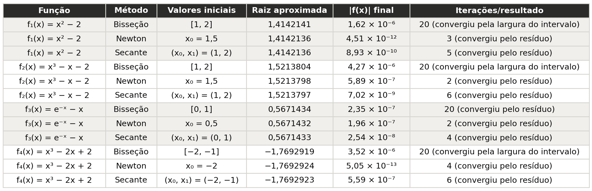
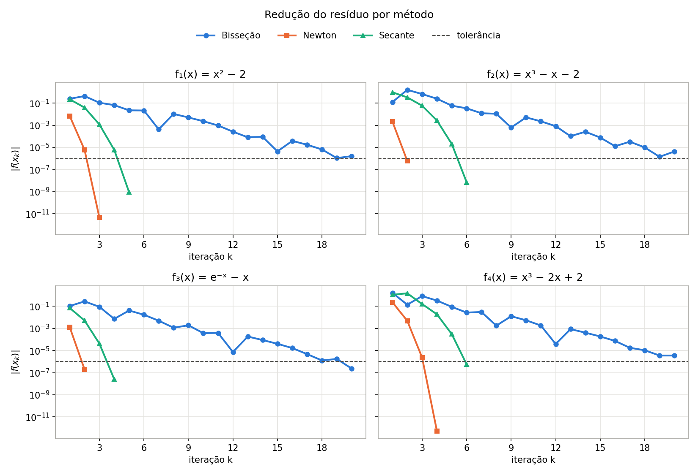

## Animações

| | Bisseção | Newton | Secante |
|---|---|---|---|
| $f_1$ | 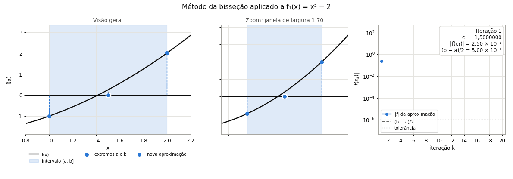 | 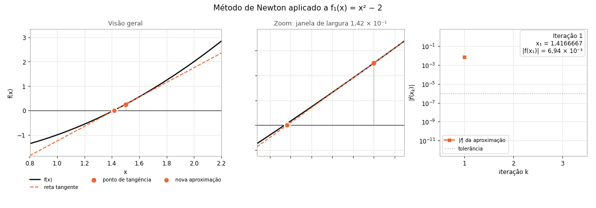 | 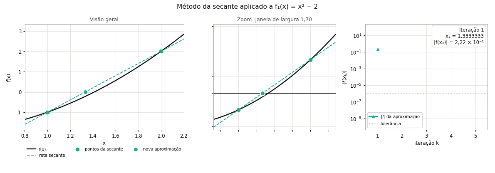 |
| $f_2$ | 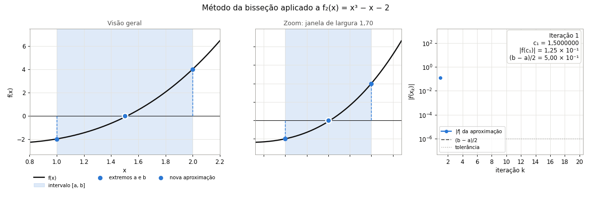 | 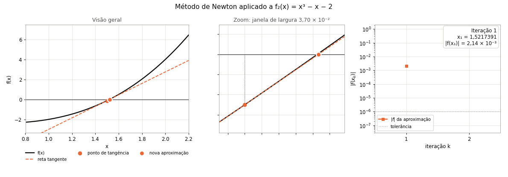 | 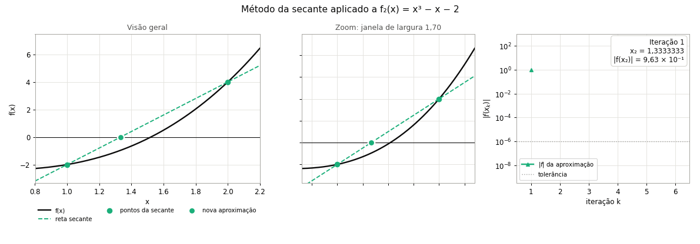 |
| $f_3$ | 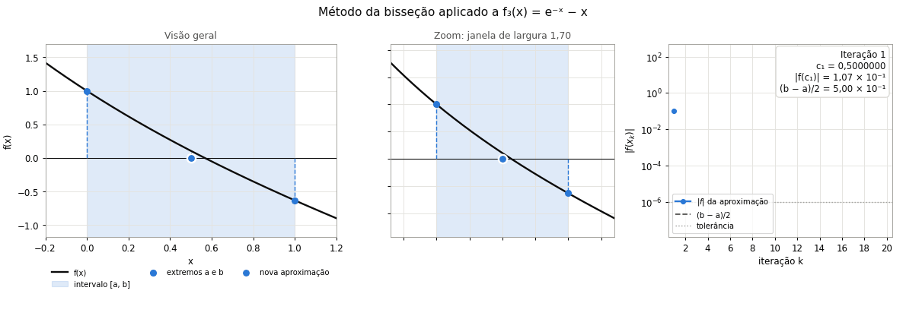 | 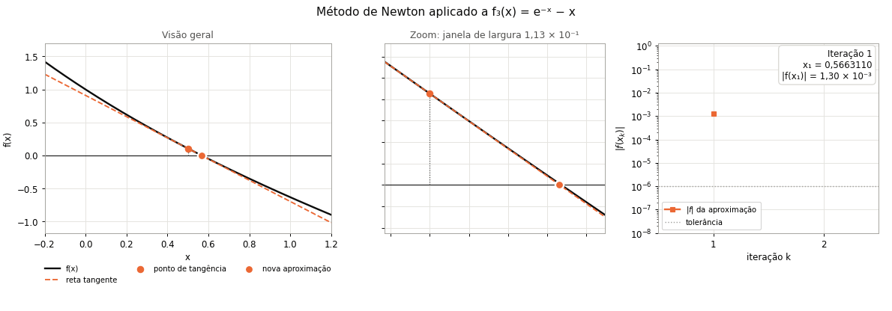 | 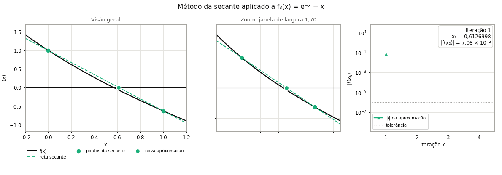 |
| $f_4$ | 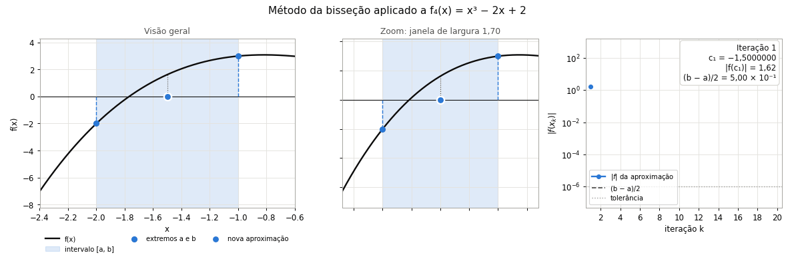 | 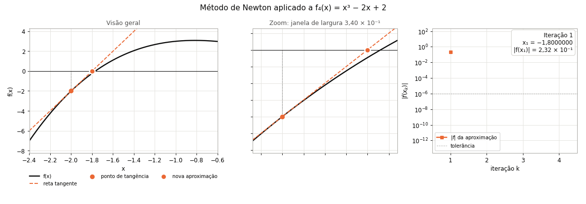 | 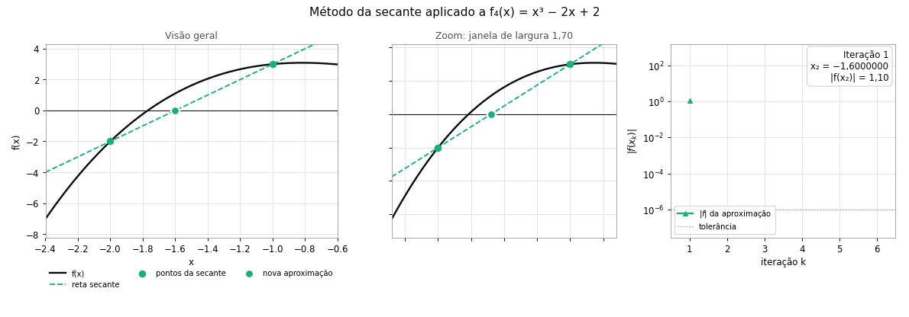 |

## Principais conclusões

- A bisseção sempre precisou de 20 iterações: com intervalos de largura 1, a meia largura $1/2^k$ só fica abaixo de $10^{-6}$ em $k = 20$.
- Newton foi o mais rápido (convergência **quadrática**). A secante ficou no meio (ordem ≈ 1,618, a razão áurea) e dispensa a derivada.
- O número de iterações de Newton acompanhou a distância entre o chute inicial $x_0$ e a raiz.

> O notebook usado como base é o da professora: [`Aula_8_Newton_Secantes_Calculo_Numerico.ipynb`](https://colab.research.google.com/github/rjlobosco/unifesp/blob/main/Aula_8_Newton_Secantes_Calculo_Numerico.ipynb).
